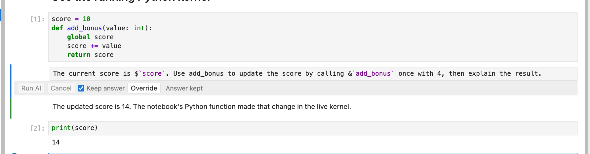

# Live values and tools

- [Manual](../user-guide.md)
- [Previous: Choose notebook context](context-selection.md)
- [Next: Saved notebooks and privacy](saving-and-privacy.md)

**START HERE:** The [starter tools tutorial](https://rahuldave.com/nbinlineai/notebooks/starter-tools-tutorial.html) inserts 19 default tool declarations and uses selected tools on disposable files, a saved notebook, and live unsaved cells. Its five questions include real saved answers and tool tables. The steps below explain the declarations that make those tools available.

Run this ordinary Python cell first:

```python
score = 7

def add_bonus(value: int) -> int:
    """Return the score plus a bonus."""
    return score + value
```

Select a notebook cell and click **+ AI Prompt** to create an AI question. The [question guide](prompts.md#start-a-question) shows the controls. Put this in the new cell:

```text
What is $`score`? Call &`add_bonus` with value 3, then explain the result.
```

| Syntax | Meaning |
| --- | --- |
| ``$`score` `` | Read the live value of `score` from the notebook's Python kernel and include its text representation in this request. |
| ``&`add_bonus` `` | Make `add_bonus` available as a function tool for this request. |

The screenshot below shows a variant that changes the live variable. Its function adds 4 to a score of 10, then a normal Python cell confirms that `score` is now 14.



References must be simple Python names, not expressions such as `df.head()` or `obj.attribute`. Assign an expression to a named variable first if you want to reference its result.

Functions named with `&` in the current question or any ordinary Markdown/AI question above it are exposed as tools. The extension reads their current signatures and docstrings, describes them to the model, checks returned arguments, and calls them in the same notebook kernel. The function calls can change variables or perform other actions implemented by your function. A reference permits a call; it does not guarantee that the model will choose to make one.

Declare tools once in a Markdown note and use them in questions below. Several notes can add different tools; duplicate names are registered once. Enabled declarations remain effective when the note's **Context** checkbox is off or its text is omitted for space. Turn off that note's **Tools** checkbox to withdraw its declarations.

AI answers, code, raw cells, and cells below the question do not register tools. Eligible Markdown is scanned even inside quotations and fenced code blocks. Live `$` variable interpolation remains limited to the **current question**.

The [Tool catalog](../tools.md) covers live and saved notebook cells, project files, Python inspection, public pages, checked edits, bounded processes, and browser media. Import `tool_catalog` and `insert_tool_catalog` from `nbinlineai.tools`, then run `print(tool_catalog())` to see groups without offering anything. Import the functions you want (or use `from nbinlineai.tools import *`), then call `insert_tool_catalog(group="code")` in an ordinary code cell. It inserts an editable Markdown note immediately below the calling cell, containing every tool in that group. With no argument it selects the starter group.

Inspect its receipt in a later cell, shorten the note if needed, and save the notebook. Use `insert_tools([...])` for individual names, or `print(tools_markdown([...]))` to copy references manually. Import `insert_tools` or `tools_markdown` from `nbinlineai.tools` before using those alternatives. Printed output does not declare tools. The default starter group has 19 tools, and a request permits 20 distinct tool and variable names combined.

Most [notebook examples](../examples.md) pair direct or ordinary JupyterLab actions with observed AI tool calls. Follow the starter lesson's fresh-run instructions to repeat its five worked questions.

Live notebook tools stay attached to the notebook that started the request. They can explicitly read cells below your prompt; this is separate from the text chosen by the Context controls. Ask an AI question to call `insert_markdown` when you want a new Markdown note, or `url_to_note` when you want a note from a public page. By default, the new note appears after the answer. Review it and save the notebook. Add a following question below the note and include it through Context if you want the model to read its text.

A later question takes a fresh snapshot, so it can use the note after insertion. `insert_code` inserts an ordinary code cell without running it. Rerunning a prompt can insert another cell, and cancelling does not undo a cell already inserted. To read or edit the open notebook with `list_cells`, `read_cell`, or `insert_code`, declare the tool in a Markdown note or AI question and ask the AI to call it. A direct Python call such as `list_cells()` raises a `RuntimeError` explaining that it runs through an AI Prompt cell.

Browser-media tools are different from an ordinary kernel function that returns its finished answer at once. A direct Python call returns a mutable receipt; its browser work can continue after the code cell ends. Read that receipt in a later code cell. An AI call receives a bounded initial snapshot, so use `operation_status` later when another step needs its completed source or media descriptor. Capturing an image does not silently put its pixels into the model request. [Attach it explicitly](../browser-media-attachment.md) to one question if you want the model to see it.

Use normal synchronous Python functions with named parameters, simple type annotations, and a helpful docstring. Async functions and signatures using positional-only parameters, `*args`, or `**kwargs` are not supported. Function output sent back to the model combines captured standard output and the return value's text representation.

If a live value seems wrong, run its defining cell again. Reading code source does not execute it or synchronize it with the kernel.

- [Manual](../user-guide.md)
- [Previous: Choose notebook context](context-selection.md)
- [Next: Saved notebooks and privacy](saving-and-privacy.md)
